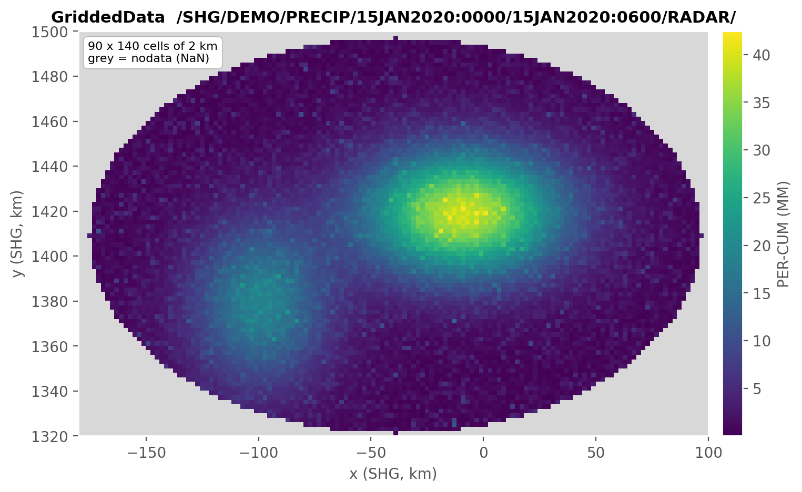

# Gridded data

Gridded data stores a raster, like a radar rainfall grid or a DEM.
In pyheclib it is a `GriddedData` record, and the data is a 2d numpy array.



## Pathname

The D and E parts are the start and end time of the grid, like
`15JAN2020:0000` and `15JAN2020:0600`. For a grid that does not change over time,
like a DEM, leave both empty.

```text
/SHG/DEMO/PRECIP/15JAN2020:0000/15JAN2020:0600/RADAR/
/SHG/DEMO/ELEVATION///DEM/
```

## The data array

- `data` is a 2d numpy array with shape `[rows, columns]`.
- The first row is the northern most row (north up), the same as most image formats.
- `NaN` means no data.
- Values are stored as 32 bit floats (`float32`).

## Write

```python
import numpy as np
import pyheclib as phl

dss_file = phl.open("example.dss")

yy, xx = np.mgrid[0:90, 0:140]
rain = (38*np.exp(-(((xx - 85)/22.0)**2 + ((yy - 40)/14.0)**2))).astype(np.float32)
rain[((xx - 70)/68.0)**2 + ((yy - 45)/44.0)**2 > 1] = np.nan     # outside the basin

grid = phl.GriddedData("/SHG/DEMO/PRECIP/15JAN2020:0000/15JAN2020:0600/RADAR/", rain,
                       cell_size=2000.0, xll=-180000.0, yll=1320000.0,
                       unit="MM", type="PER-CUM",
                       grid_type="ALBERS", srs_name="SHG", time_zone="UTC")
dss_file.write(grid)
```

`xll` and `yll` are the x and y of the lower left corner of the grid, in the grid's
coordinate system. They must be a whole number of cells away from `origin` (default `(0, 0)`).

Writing replaces the whole record.

## Read

```python
g = dss_file.read("/SHG/DEMO/PRECIP/15JAN2020:0000/15JAN2020:0600/RADAR/")   # GriddedData
g.data              # 2d numpy array, NaN is no data
g.shape             # (rows, columns)
g.cell_size         # 2000.0
g.extent            # (xmin, xmax, ymin, ymax)
g.lower_left_cell   # lower left cell index from origin
g.start_time, g.end_time
```

To plot it with matplotlib:

```python
import matplotlib.pyplot as plt

plt.imshow(g.data, extent=g.extent)
plt.colorbar(label=g.unit)
plt.show()
```

## Delete

One grid:

```python
dss_file.delete("/SHG/DEMO/PRECIP/15JAN2020:0000/15JAN2020:0600/RADAR/")
```

Or every grid of a parameter at once, using `*` in the D and E parts:

```text
dss_file.delete("/SHG/DEMO/PRECIP/*/*/RADAR/")
```

## Options

| Option | Default | Meaning |
|---|---|---|
| `cell_size` | required | cell width and height |
| `xll`, `yll` | required | lower left corner of the grid |
| `unit` | `""` | unit of the values, like `MM` |
| `type` | `"INST-VAL"` | `INST-VAL`, `INST-CUM`, `PER-AVER`, `PER-CUM` or `FREQ` |
| `grid_type` | `"SPECIFIED"` | `UNDEFINED`, `HRAP`, `ALBERS` or `SPECIFIED` |
| `srs_name` | `""` | name of the coordinate system, like `SHG` |
| `srs_wkt` | `""` | coordinate system as WKT text |
| `origin` | `(0, 0)` | origin of the grid system |
| `data_source` | `""` | where the data came from |
| `time_zone` | `""` | time zone name, like `UTC` |
