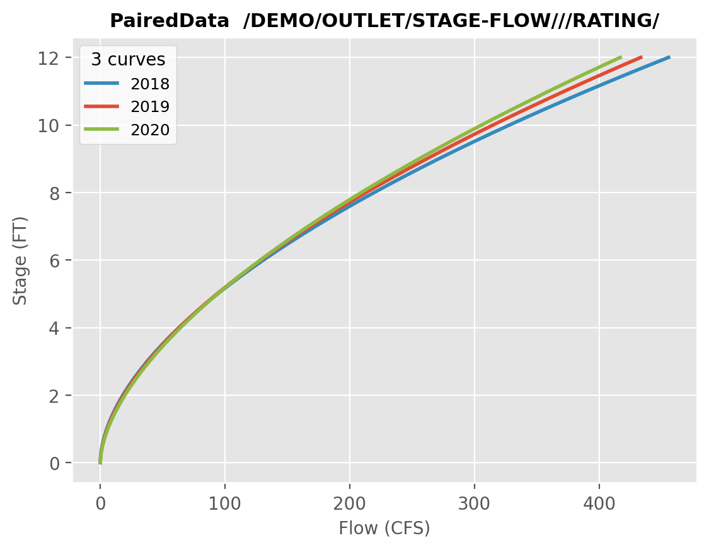

# Paired data

Paired data stores one or more curves that share the same x values, like a
stage-flow rating table or an elevation-storage table. In pyheclib it is a `PairedData` record.



## Pathname

Paired data has no dates, so the D and E parts are usually empty. The C part
names both parameters, like `STAGE-FLOW`.

```text
/DEMO/OUTLET/STAGE-FLOW///RATING/
```

## Write

`x` is a 1d array. `y` has one row per curve, so its shape is `[number of curves, number of points]`.
`labels` gives each curve a name and is optional.

```python
import numpy as np
import pyheclib as phl

dss_file = phl.open("example.dss")

stage = np.linspace(0, 12, 49)
rating = phl.PairedData("/DEMO/OUTLET/STAGE-FLOW///RATING/",
                        x=stage,
                        y=np.vstack([5.2*stage**1.80, 5.6*stage**1.75, 6.1*stage**1.70]),
                        x_unit="FT", y_unit="CFS", labels=["2018", "2019", "2020"])
dss_file.write(rating)
```

For a single curve, `y` can be a 1d array.

From a pandas DataFrame, where the index is x and each column is a curve:

```python
import pandas as pd

df = pd.DataFrame({"2020": 6.1*stage**1.70}, index=stage)
dss_file.write(phl.PairedData.from_dataframe("/DEMO/OUTLET/STAGE-FLOW///RATING/", df,
                                             x_unit="FT", y_unit="CFS"))
```

Writing replaces the whole record.

## Read

```python
rec = dss_file.read("/DEMO/OUTLET/STAGE-FLOW///RATING/")   # PairedData
rec.x, rec.y          # numpy arrays
rec.n_curves          # 3
rec.labels            # ['2018', '2019', '2020']
df = rec.to_dataframe()   # index is x, one column per curve
```

## Delete

```python
dss_file.delete("/DEMO/OUTLET/STAGE-FLOW///RATING/")
```

## Options

| Option | Default | Meaning |
|---|---|---|
| `x_unit`, `y_unit` | `""` | units of x and y |
| `x_type`, `y_type` | `"Linear"` | axis type, like `Linear` or `Log` |
| `labels` | `[]` | one name per curve |
| `time_zone` | `""` | time zone name |
