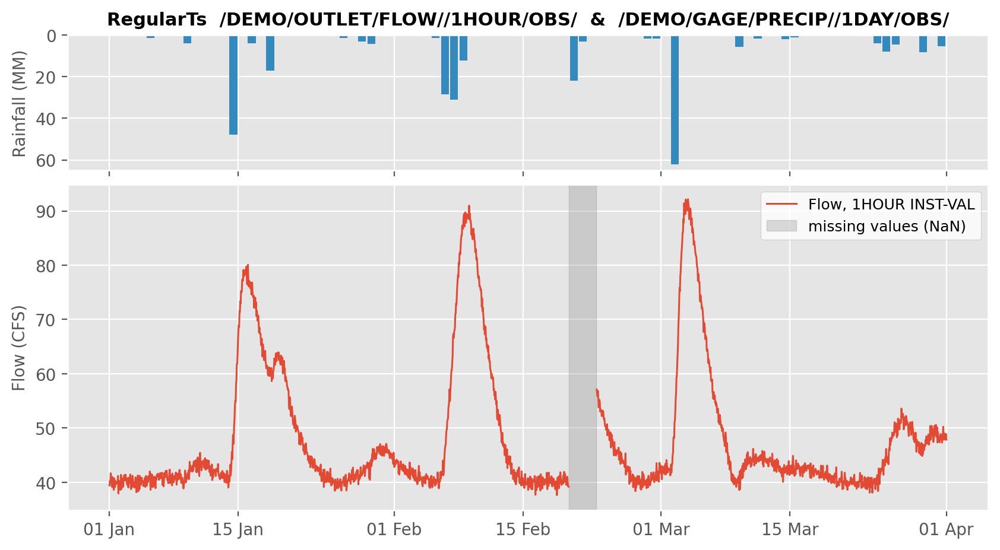

# Regular time series

A regular time series has one value per fixed time step, like hourly flow or daily rainfall.
In pyheclib it is a `RegularTs` record.



## Pathname

The E part sets the time step. Common values are `15MINUTE`, `1HOUR`, `6HOUR`, `1DAY`,
`1MONTH` and `1YEAR`. Leave the D part empty, pyheclib fills in the dates.

```text
/DEMO/OUTLET/FLOW//1HOUR/OBS/
```

## Write

From a list of values and the time of the first value:

```python
import numpy as np
import pandas as pd
import pyheclib as phl

dss_file = phl.open("example.dss")

precip = phl.RegularTs("/DEMO/GAGE/PRECIP//1DAY/OBS/",
                       values=[0.0, 12.5, 48.0, 3.1, 0.0],
                       start="2020-01-14", unit="MM", type="PER-CUM")
dss_file.write(precip)
```

From a pandas Series with a time index:

```python
hours = pd.date_range("2020-01-14 01:00", periods=96, freq="h")
flow = pd.Series(np.linspace(40, 90, 96), index=hours)
flow.iloc[70:76] = np.nan                     # missing values

record = phl.RegularTs.from_series("/DEMO/OUTLET/FLOW//1HOUR/OBS/", flow,
                                   unit="CFS", type="INST-VAL")
dss_file.write(record)
```

Writing replaces stored values inside the time span of the new record.
Values outside that span are kept.

## Read

Read the whole series:

```python
rts = dss_file.read("/DEMO/OUTLET/FLOW//1HOUR/OBS/")    # RegularTs
rts.values        # numpy array
rts.times         # pandas DatetimeIndex
rts.start, rts.interval, rts.unit, rts.type
series = rts.to_series()                               # pandas Series
```

Read only a time window with `start` and `end`:

```python
window = dss_file.read("/DEMO/OUTLET/FLOW//1HOUR/OBS/",
                       start="2020-01-15 12:00", end="2020-01-15 18:00")
```

## Delete

To delete only some blocks, give a date range in the D part. DSS stores a long series in
blocks (for hourly data, one block per month), and this removes the blocks in that range,
not single values. `catalog(condensed=True)` shows the date range of each series.

```python
dss_file.delete("/DEMO/OUTLET/FLOW/01JAN2020-31JAN2020/1HOUR/OBS/")   # the January 2020 block
```

A pathname with an empty D part deletes the whole series, all blocks:

```python
dss_file.delete("/DEMO/OUTLET/FLOW//1HOUR/OBS/")
```

## Options

| Option | Default | Meaning |
|---|---|---|
| `unit` | `""` | unit of the values, like `CFS` or `MM` |
| `type` | `"INST-VAL"` | `INST-VAL`, `INST-CUM`, `PER-AVER`, `PER-CUM` or `FREQ` |
| `time_zone` | `""` | time zone name, like `UTC` |
| `save_as_float` | `False` | store values as 32 bit floats to save space |

!!! note
    Monthly and yearly values that cover a whole period are stamped at the start of the
    next period. For example, the January 2020 value is at `01FEB2020 00:00`.
