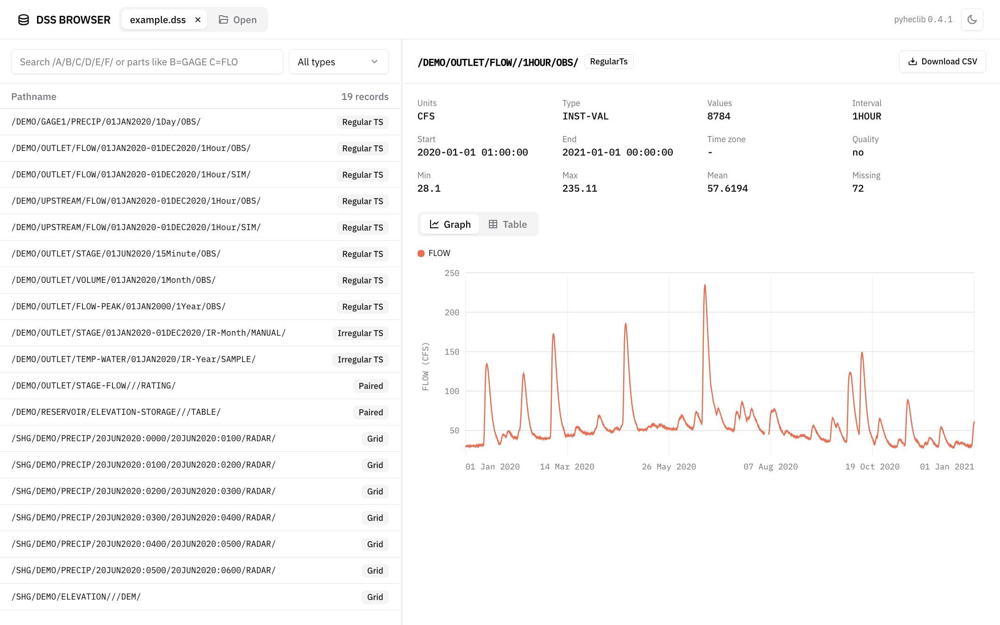
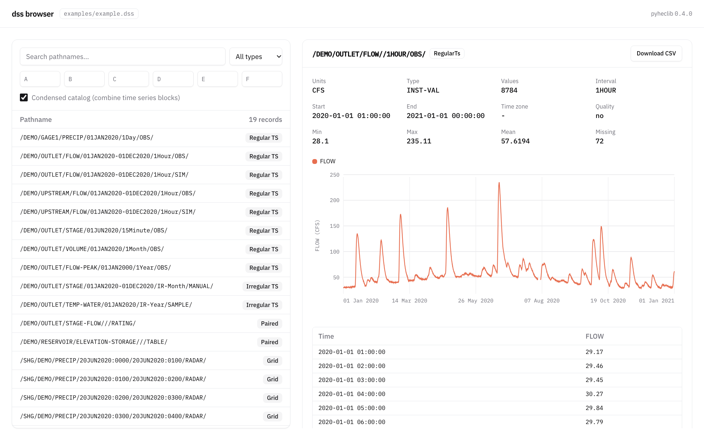

# DSS viewer

The DSS viewer lets you look inside DSS files in your web browser. It runs on your own
computer and needs nothing besides pyheclib.





## Get it

The viewer comes with pyheclib as the `dss_browser` command:

```bash
pip install pyheclib
```

It is a single script,
[`pyheclib/tools/dss_browser.py`](https://github.com/nzahasan/pyheclib/tree/main/pyheclib/tools),
and also runs as `python -m pyheclib.tools.dss_browser`.

## Start it

```bash
dss_browser example.dss
```

The viewer opens in your web browser at `http://127.0.0.1:8765/`.
Press `Ctrl+C` in the terminal to stop it.

You can open more than one file:

```bash
dss_browser basin.dss radar.dss
```

Options:

| Option | Default | Meaning |
|---|---|---|
| `--port` | `8765` | port to serve on |
| `--host` | `127.0.0.1` | address to serve on |
| `--no-browser` | off | do not open the web browser for you |

## Use it

- **Open files**: use the **Open** button, or drag `.dss` files onto the page. Each file gets its own tab.
- **Find records**: type in the search box. Every word must match.
    - A plain word matches anywhere in the pathname, like `FLOW` or `/OUTLET/FLOW/`.
    - `B=GAGE` finds `GAGE` anywhere in part B. Add `*` or `?` to match the whole part instead, like `C=FLOW*` (FLOW, FLOW-PEAK but not STAGE-FLOW).
    - The type menu shows only one record type, like regular time series or grids.
- **View a record**: click a record to see its metadata and simple statistics. Switch between
  **Graph** (a chart, or an image for grids) and **Table** to see the data.
- **Download**: click **Download CSV** to save the record as a CSV file.
- **Share a link**: each record has its own address, like `/?file=1&path=/A/B/C/D/E/F/`.
- **Light or dark**: the button at the top right switches the theme. Your choice is remembered.
- **Resize**: drag the line between the record list and the record to change their widths.

Time series are listed once each, with their full date range, instead of once per block.

If you stop the server, the page fades out. It reconnects when the server starts again.

## Try it with the example file

The repository has an example file with every record type:

```bash
dss_browser examples/example.dss
```
