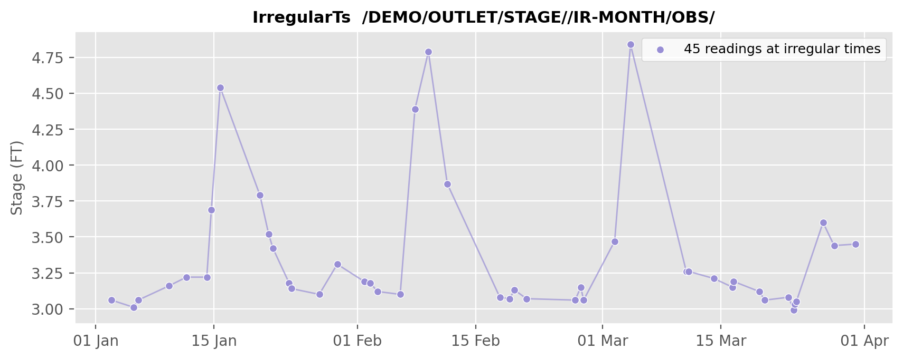

# pyheclib
[](#)
[](https://github.com/nzahasan/pyheclib/actions/workflows/test.yml)
[](https://opensource.org/licenses/MIT)

HEC-DSS, is a database system designed by [U.S. Army Corps of Engineers' Hydrologic 
Engineering Center](https://www.hec.usace.army.mil/) to efficiently store and retrieve 
typically sequential scientific data. HEC-DSS is incorporated into most of HEC’s 
major application programs like HEC-HMS, HEC-RAS etc.

pyheclib reads & writes **HEC-DSS version 7** files through the HEC-DSS C API
(`hecdss` 7-JA-7, bundled for macOS (arm64 / x86_64), Linux x86_64 and Windows x64).
DSS version 6 files are not supported, convert them to version 7 with HEC-DSSVue.

record types implemented in pyheclib are:  
	- Time Series Data (Regular & Irregular) as pandas Series / DataFrame
	- Paired Data (multiple curves, labels) as pandas DataFrame
	- Gridded Data as 2d numpy array with metadata

code layout: `pyheclib/records.py` (record classes), `pyheclib/dsspath.py` (`DssPath`), `pyheclib/dssfile.py`
(`open` / `DssFile`), `src/_core.pyx` (thin wrapper of the C API)


### Install

```bash
# macOS / linux / windows, python >= 3.9
$ pip3 install https://github.com/nzahasan/pyheclib/zipball/master 

# from a clone
$ pip3 install -r requirements.txt
$ python3 setup.py build_ext --inplace   # rebuild after editing src/*.pyx / *.pxd
$ pytest                                # tests also run the README examples
```

# Usage

Each record type is a class holding the pathname, data and all metadata of a
record. Records are created on their own, written with `write` and `read`
returns the same record type:

| record        | data                                   | pandas                                   |
|---------------|----------------------------------------|------------------------------------------|
| `RegularTs`   | `values`, `start` (interval = E part)  | `to_series()` / `RegularTs.from_series`  |
| `IrregularTs` | `times`, `values`                      | `to_series()` / `IrregularTs.from_series`|
| `PairedData`  | `x`, `y` `[n_curves, n_ordinates]`     | `to_dataframe()` / `PairedData.from_dataframe` |
| `GriddedData` | `data` north-up 2d array, NaN = nodata | -                                        |

### Open a file

```python
import numpy as np
import pandas as pd
import pyheclib as phl

dss_file = phl.open("example.dss")     # opens (or creates) a dss version 7 file
```

`phl.open` also works as a context manager: `with phl.open("example.dss") as dss_file: ...`

### Regular time series

The interval comes from the E part of the pathname (`1HOUR`, `15MINUTE`, `1DAY`, `1MONTH` ...).
An empty D part reads the whole series, `start` / `end` read a time window. Missing values are `NaN`.

```python
# from values and the time of the first value
precip = phl.RegularTs("/DEMO/GAGE/PRECIP//1DAY/OBS/", values=[0.0, 12.5, 48.0, 3.1, 0.0],
                       start="2020-01-14", unit="MM", type="PER-CUM")
dss_file.write(precip)

# from a pandas Series
hours = pd.date_range("2020-01-14 01:00", periods=96, freq="h")
flow = pd.Series(40 + 50*np.exp(-((np.arange(96) - 40) / 12.0)**2), index=hours)
flow.iloc[70:76] = np.nan
dss_file.write(phl.RegularTs.from_series("/DEMO/OUTLET/FLOW//1HOUR/OBS/", flow, unit="CFS", type="INST-VAL"))

rts = dss_file.read("/DEMO/OUTLET/FLOW//1HOUR/OBS/")          # -> RegularTs
print(rts.unit, rts.type, rts.interval, rts.start)            # CFS INST-VAL 1HOUR 2020-01-14 01:00:00
series = rts.to_series()                                      # pandas Series indexed by time

window = dss_file.read("/DEMO/OUTLET/FLOW//1HOUR/OBS/", start="2020-01-15 12:00", end="2020-01-15 18:00")
```


### Irregular time series

Use an `IR-*` (or `~*`) E part, times are kept with second resolution. Writing to an existing
irregular series replaces the stored values within the time span of the new record.

```python
stage = phl.IrregularTs("/DEMO/OUTLET/STAGE//IR-MONTH/OBS/",
                        times=pd.to_datetime(["2020-01-14 08:13:00", "2020-01-15 07:30:15", "2020-01-16 16:45:00"]),
                        values=[3.1, 4.6, 3.4], unit="FT", type="INST-VAL")
dss_file.write(stage)

its = dss_file.read("/DEMO/OUTLET/STAGE//IR-MONTH/OBS/")      # -> IrregularTs
its.times, its.values, its.to_series()
```



### Paired data

`x` is shared by all curves, `y` is `[n_curves, n_ordinates]`, optional `labels` name the curves.

```python
h = np.linspace(0, 12, 49)
rating = phl.PairedData("/DEMO/OUTLET/STAGE-FLOW///RATING/", x=h,
                        y=np.vstack([5.2*h**1.80, 5.6*h**1.75, 6.1*h**1.70]),
                        x_unit="FT", y_unit="CFS", labels=["2018", "2019", "2020"])
dss_file.write(rating)

pd_rec = dss_file.read("/DEMO/OUTLET/STAGE-FLOW///RATING/")   # -> PairedData
pd_rec.n_curves, pd_rec.labels
df = pd_rec.to_dataframe()                                    # index: STAGE, columns: 2018 2019 2020
```


### Gridded data

`data` is a north-up 2d array (first row is the northern most), `NaN` is nodata. `xll`, `yll` is
the lower left corner in the grid's coordinate system. The D & E parts are the start & end time of
the grid, leave both empty for time invariant grids (e.g. a DEM).

```python
yy, xx = np.mgrid[0:90, 0:140]
field = (38*np.exp(-(((xx - 85)/22.0)**2 + ((yy - 40)/14.0)**2))).astype(np.float32)
field[((xx - 70)/68.0)**2 + ((yy - 45)/44.0)**2 > 1] = np.nan       # outside the basin

grid = phl.GriddedData("/SHG/DEMO/PRECIP/15JAN2020:0000/15JAN2020:0600/RADAR/", field,
                       cell_size=2000.0, xll=-180000.0, yll=1320000.0, unit="MM", type="PER-CUM",
                       grid_type="ALBERS", srs_name="SHG", time_zone="UTC")
dss_file.write(grid)

g = dss_file.read("/SHG/DEMO/PRECIP/15JAN2020:0000/15JAN2020:0600/RADAR/")   # -> GriddedData
g.data.shape, g.cell_size, g.extent, g.lower_left_cell, g.start_time
```


### Pathnames & catalog

`DssPath` splits a pathname into its parts. Records and `DssFile` methods accept a
`DssPath` or a plain string, and `catalog()` returns `DssPath` objects.

```python
path = phl.DssPath("/DEMO/OUTLET/FLOW/01JAN2020/1HOUR/OBS/")
path.C                        # 'FLOW'
path.replace(F="SIM")         # DssPath('/DEMO/OUTLET/FLOW/01JAN2020/1HOUR/SIM/')
path.without_date()           # DssPath('/DEMO/OUTLET/FLOW//1HOUR/OBS/')
phl.DssPath.from_parts(A="DEMO", C="STAGE-FLOW", F="RATING")

dss_file.catalog()                      # every record, one path per time series block
dss_file.catalog(condensed=True)        # time series blocks combined into one path, the D part
                                        # is the block date range, e.g. 01JAN2020-01MAR2020
dss_file.catalog("/DEMO/*/FLOW/*/*/*/", condensed=True, with_types=True)
dss_file.read(dss_file.catalog(condensed=True)[0])   # condensed paths read the whole series
```

### Find & delete

`find` and `delete` accept `*` wild characters at the start or end of any pathname part.
A time series path with an empty D part matches all its dated blocks, a condensed D part
(`01JAN2020-01MAR2020`) the blocks in that range. `delete` returns the deleted paths.

```python
dss_file.find("/DEMO/*/*/*/*/OBS/")                    # every OBS record of basin DEMO
dss_file.find("/*/*/STAGE*/*/*/*/")                    # STAGE and STAGE-FLOW records

dss_file.delete("/DEMO/OUTLET/STAGE-FLOW///RATING/")   # one record
dss_file.delete("/DEMO/OUTLET/FLOW//1HOUR/OBS/")       # all blocks of a time series
dss_file.delete("/SHG/*/*/*/*/*/")                     # everything with A part SHG
dss_file.close()
```

The figures above are drawn from records written to and read back from a dss file by
[examples/make_readme_figures.py](examples/make_readme_figures.py):

```bash
$ python3 examples/make_readme_figures.py          # writes assets/readme/*.png
```

### Notebooks

Each notebook writes records, reads them back and checks the round trip:

- [01_regular_timeseries.ipynb](notebooks/01_regular_timeseries.ipynb)
- [02_irregular_timeseries.ipynb](notebooks/02_irregular_timeseries.ipynb)
- [03_paired_data.ipynb](notebooks/03_paired_data.ipynb)
- [04_gridded_data.ipynb](notebooks/04_gridded_data.ipynb)
- [05_catalog_paths_delete.ipynb](notebooks/05_catalog_paths_delete.ipynb)

If a notebook reports an unexpected `TypeError` after updating pyheclib, restart the kernel;
the first cell prints the pyheclib version and location in use.

Notes:
- quality flags are read when present but not written (the hecdss 7-JA-7 store functions drop them)
- gridded data is stored as float32

for a detailed documentation visit https://nzahasan.github.io/pyheclib


### Resources  

- [HEC-DSS C Library](https://www.hec.usace.army.mil/software/hec-dss/downloads.aspx) 
- [HEC-DSSVue (A java based gui)](https://www.hec.usace.army.mil/software/hec-dssvue/)

### Example file

[examples/example.dss](examples/example.dss) contains every record type (hourly, 15 minute,
daily, monthly & yearly regular series, irregular series, rating & storage tables, hourly
radar grids and a DEM). Regenerate it with `python3 examples/make_example_dss.py`, and browse it with:

```bash
$ python3 tools/dss_browser.py examples/example.dss
```

### Tools
- `tools/dss_browser.py file.dss [--port 8765] [--no-browser]` : browse a file in the web browser
- `tools/dss_catalog.py file.dss [filter] [--condensed]` : list records
- `tools/dssrec2csv.py file.dss pathname out.csv` : export a record to csv

#### dss browser

A single file web viewer using the python built in http server, [htmx](https://htmx.org) and
[shadcn/ui](https://ui.shadcn.com) styling. Filter the catalog by text, record type or pathname
parts (with `*`), click a record to see its metadata, statistics, chart / grid image and data,
and download it as csv. Each record has its own link (`/?path=/A/B/C/D/E/F/`), and the page blurs
while the server is stopped and reconnects when it is back.

```bash
$ python3 tools/dss_browser.py example.dss
serving example.dss at http://127.0.0.1:8765/  (ctrl+c to stop)
```


